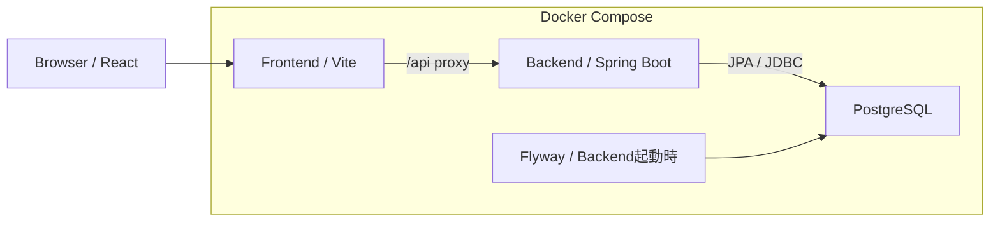

# Seat Reservation System

Java 25 / Spring Boot / Reactを使用した座席予約システム。

既存のJava実務経験を基盤に、Modern Java / Backend / AWSへの技術領域拡張を目的として開発する。

## 目的

座席予約を題材に、以下の技術領域を実践する。

- **Modern Java**：Java 25 / Spring BootによるREST API開発
- **Transaction / Concurrency**：PostgreSQLを用いたデータ整合性と同時予約の制御
- **Authentication / Authorization**：Spring Security / Amazon Cognitoによる認証認可
- **AWS / IaC**：ECS/Fargate、RDS、Terraformによるクラウド環境構築
- **Testing / CI/CD**：Integration Test、GitHub Actionsによる自動検証・デプロイ

## 機能概要

座席マスタに登録した座席を日付ごとに予約するシステム。初期構成は30席とする。

- 日付別の座席状況確認
- 空席の予約と自分の予約のキャンセル
- 空席・自席・他ユーザー予約席の区別
- Pollingによる座席状況の更新
- ローカル用の仮ユーザー切替による複数ユーザーの動作確認

ユーザー登録・ログイン、管理者による予約管理はPhase 3で対応予定。現在は認証のないローカル開発用の構成とする。

## 画面構成

画面イメージと画面構成の詳細は[フロントエンド仕様](doc/system-design/frontend-specification.md)を参照。

画面の基本操作は[Frontend README](frontend/README.md#基本操作フロー)を参照。

## アーキテクチャ

### Phase 1：ローカル環境



Frontend・Backend・Databaseをルートの[compose.yml](compose.yml)で一括管理する。

### 最終構成（予定）

- Frontend：S3 + CloudFront
- Backend：ALB + ECS/Fargate（Spring Boot）
- Database：RDS PostgreSQL
- Authentication：Amazon Cognito + Spring Security
- Infrastructure：Terraform
- CI/CD：GitHub Actions + GitHub OIDC

## 技術スタック

| 領域 | 技術 |
| --- | --- |
| Frontend | React / TypeScript / Vite |
| Backend | Java 25 / Spring Boot 4.1.1 / Spring MVC / Spring Data JPA |
| Database・マイグレーション | PostgreSQL 17 / Flyway |
| ビルド・ローカル環境 | Maven Wrapper / Node.js 24 / npm / Docker Compose |
| Backendテスト | JUnit / Testcontainers |
| Frontendテスト | Vitest / Testing Library / Playwright |

依存バージョンの詳細は[backend/pom.xml](backend/pom.xml)と[frontend/package.json](frontend/package.json)を参照。

## ローカル起動・停止

### 前提

- DockerとDocker Compose v2を利用でき、Dockerが起動していること（WindowsではDocker DesktopのLinuxコンテナを使用）。
- 以下のコマンドはリポジトリのルートで実行する。
- 一括起動ではコンテナ内でビルドするため、ホストへのJava・Node.jsのインストールは不要。初回はイメージ・依存関係のダウンロードが必要。

### 一括起動

```sh
docker compose up --build -d --wait
docker compose ps
```

DB、Backend、Frontendの順にヘルスチェックを確認して起動する。初回のDB作成時にはFlywayがテーブルと30席の初期データを登録する。

| 接続先 | URL・ポート |
| --- | --- |
| 予約画面 | http://localhost:5173 |
| Backendヘルスチェック | http://localhost:8080/actuator/health |
| PostgreSQL（ローカル接続用） | localhost:5432 |

各ポートはループバックアドレスにのみ公開する。ポートが競合する場合は、`FRONTEND_PORT`・`BACKEND_PORT`・`POSTGRES_PORT`を環境変数で指定して起動する。表の接続先も指定したポートに読み替える。

ログを確認する場合：

```sh
docker compose logs -f backend frontend postgres
```

Frontendの`src`など、Composeでマウントしたファイルの変更はViteが反映する。Windowsでファイル変更を検知しない場合は、`VITE_USE_POLLING=true`を環境変数で指定して再起動する（座席情報の定期更新とは別の設定）。Backendや依存関係を変更した場合は、上記の起動コマンドを再実行して再ビルドする。

### 一括停止

```sh
docker compose down
```

予約データはボリュームに保持される。データを破棄して初期状態に戻す場合のみ、`docker compose down --volumes`を実行してから再起動する。

Composeのビルドではテストを実行しない。開発・検証手順は[Frontend README](frontend/README.md)と[Backend README](backend/README.md)を参照。

## 開発ロードマップ

| Phase             | 内容                                                |
| ----------------- | --------------------------------------------------- |
| 1. MVP            | ローカル環境で座席照会・予約・キャンセルを実装      |
| 2. Concurrency    | 同時予約制御、Transaction設計、並列Integration Test |
| 3. Authentication | Cognito / JWT / Spring Securityによる認証認可       |
| 4. AWS            | TerraformによるAWS環境構築とCI/CD                   |

## 開発方針

過剰設計を避け、各Phaseで必要な機能を段階的に実装する。

要件・設計・技術判断は自身で行い、AIは実装補助・調査・レビューに限定して利用する。

主要な設計判断はADR（Architecture Decision Record）として記録する。

## ドキュメント

| 種類 | ドキュメント |
| --- | --- |
| Frontend開発・検証 | [Frontend README](frontend/README.md) |
| Backend開発・検証 | [Backend README](backend/README.md) |
| 詳細仕様 | [API定義](doc/system-design/api-definition.md)、[データモデル定義](doc/system-design/data-model.md)、[Frontend仕様](doc/system-design/frontend-specification.md) |
| 検証項目 | [API結合テスト](doc/testing/api-integration-test-matrix.md)、[Frontendテスト](doc/testing/frontend-test-matrix.md) |

設計判断の記録：

- [ADR-001：座席マスタと予約データの分離](doc/adr/adr-001.md)
- [ADR-002：Phase 1における仮ユーザー識別方式](doc/adr/adr-002.md)
- [ADR-003：APIエラーレスポンスの標準化](doc/adr/adr-003.md)
- [ADR-004：ローカル環境のCompose統合起動](doc/adr/adr-004.md)
