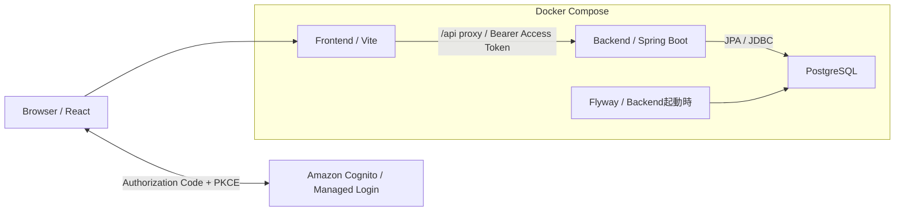

# Seat Reservation System

Java 25 / Spring Boot / Reactを使用した座席予約システム。

既存のJava実務経験を基盤に、Modern Java / Backend / AWSへの技術領域拡張を目的として開発する。

## 目的

座席予約を題材に、以下の技術領域を実践する。

- **Modern Java**：Java 25 / Spring BootによるREST API開発
- **Transaction / Concurrency**：PostgreSQLを用いたデータ整合性と同時予約の制御
- **Authentication / Authorization**：Spring Security / Amazon Cognitoによる認証認可
- **AWS / IaC**：ECS/Fargate、RDS、Terraformによるクラウド環境構築
- **Testing / CI/CD**：Integration Test、GitHub Actionsによる自動検証・デプロイ

## 機能概要

座席マスタに登録した座席を日付ごとに予約するシステム。初期構成は30席とする。

- 日付別の座席状況確認
- 空席の予約と自分の予約のキャンセル
- 空席・自席・他ユーザー予約席の区別
- Pollingによる座席状況の更新
- Amazon Cognitoによるログイン・ログアウト
- 管理者による指定日の全予約取得と任意ユーザーの予約キャンセル

## 画面構成

画面イメージと画面構成の詳細は[フロントエンド仕様](doc/system-design/frontend-specification.md)を参照。

画面の基本操作は[Frontend README](frontend/README.md#基本操作フロー)を参照。

## アーキテクチャ

### ローカル環境



Frontend・Backend・Databaseをルートの[compose.yml](compose.yml)で一括管理する。

### AWS環境

- Frontend：S3 + CloudFront
- Backend：Internal ALB + ECS/Fargate（Spring Boot）
- Database：RDS PostgreSQL
- Authentication：Amazon Cognito + Spring Security
- Infrastructure：Terraform
- CI/CD：GitHub Actions + GitHub OIDC

APIへの通信はCloudFront VPC Origins経由でInternal ALBからECSへ転送する。詳細は[AWSアーキテクチャ設計](doc/system-design/aws-architecture.md)を参照。

## 技術スタック

| 領域 | 技術 |
| --- | --- |
| Frontend | React / TypeScript / Vite |
| Backend | Temurin 25.0.5+8 / Spring Boot 4.1.1 / Spring MVC / Spring Data JPA |
| Database・マイグレーション | PostgreSQL 17.11（ローカル・テスト・AWS RDS共通）/ Flyway |
| ビルド・ローカル環境 | Maven Wrapper / Node.js 26.13.0 / npm / Docker Compose |
| Backendテスト | JUnit / Testcontainers |
| Frontendテスト | Vitest / Testing Library / Playwright |

Javaは`.java-version`、Node.jsは`.node-version`をホスト開発・CIの基準とし、Dockerも同じ更新版を使用する。

依存バージョンの詳細は[backend/pom.xml](backend/pom.xml)と[frontend/package.json](frontend/package.json)を参照。

## ローカル起動・停止

### 前提

- DockerとDocker Compose v2を利用でき、Dockerが起動していること（WindowsではDocker DesktopのLinuxコンテナを使用）。
- 以下のコマンドはリポジトリのルートで実行する。
- 一括起動ではコンテナ内でビルドするため、ホストへのJava・Node.jsのインストールは不要。初回はイメージ・依存関係のダウンロードが必要。

Cognitoの設定を準備し、ルートの`.env.example`を`.env`へコピーして設定する。詳細は[認証設定](frontend/README.md#認証設定)を参照。

### 一括起動

```sh
docker compose up --build -d --wait
docker compose ps
```

DB、Backend、Frontendの順にヘルスチェックを確認して起動する。Backendは`/actuator/health`でDB接続を含む正常性を確認する。初回のDB作成時にはFlywayがテーブルと30席の初期データを登録する。

| 接続先 | URL・ポート |
| --- | --- |
| アプリ画面（未認証時はログイン画面） | http://localhost:5173 |
| Backend API（認証必須） | http://localhost:8080/api/seats |
| PostgreSQL（ローカル接続用） | localhost:5432 |

各ポートはループバックアドレスにのみ公開する。ポートが競合する場合は、`FRONTEND_PORT`・`BACKEND_PORT`・`POSTGRES_PORT`を環境変数で指定して起動する。表の接続先も指定したポートに読み替える。

ログを確認する場合：

```sh
docker compose logs -f backend frontend postgres
```

Frontendの`src`など、Composeでマウントしたファイルの変更はViteが反映する。Windowsでファイル変更を検知しない場合は、`VITE_USE_POLLING=true`を環境変数で指定して再起動する（座席情報の定期更新とは別の設定）。Backendや依存関係を変更した場合は、上記の起動コマンドを再実行して再ビルドする。

### 一括停止

```sh
docker compose down
```

予約データはボリュームに保持される。データを破棄して初期状態に戻す場合のみ、`docker compose down --volumes`を実行してから再起動する。

Composeのビルドではテストを実行しない。開発・検証手順は[Frontend README](frontend/README.md)と[Backend README](backend/README.md)を参照。

### Cognitoを使わない固定ユーザーでの操作

開発用の専用Composeで、認証を省略して予約・管理者機能を操作できる。Cognitoの設定は不要。

```powershell
docker compose -f compose.demo.yml up --build -d --wait
docker compose -f compose.demo.yml down
```

既定は`demo-user-1`／一般ユーザー。管理者に切り替える場合は、同じターミナルで設定して再起動する。

```powershell
$env:DEMO_USER_ID='admin-user'
$env:DEMO_ROLE='ADMIN'
docker compose -f compose.demo.yml up -d --wait
```

`DEMO_ROLE`は`USER`または`ADMIN`。変更後はブラウザを再読み込みする。一般ユーザーへ戻す場合はIDと権限を再設定する。全アクセスがサーバーに設定した同一ユーザーとなり、ブラウザごとにユーザーを切り替えることはできない。

通常構成と同じポートを使うため、切替前に起動中の構成を停止する。同時起動する場合は`FRONTEND_PORT`・`BACKEND_PORT`・`POSTGRES_PORT`を分ける。DBは`seat-reservation-demo`プロジェクト専用ボリュームに保存し、Cognito用とは共有しない。

固定ユーザーモードはローカル操作確認専用。JWT署名検証・Cognitoログイン／ログアウトの確認には通常の`compose.yml`を使う。ポートはループバックのみへ公開し、この構成を外部公開しない。

## CI/CD

[GitHub Actions](.github/workflows/ci.yml)で、main向けPR・mainへのPush・手動実行時に以下を検証する。

- Backend：Java 25でビルド、単体・認証認可・Testcontainers結合テスト、Dockerイメージのビルド検証（Pushなし）。
- Frontend：Node.js 26.13.0で書式チェック、単体テスト、ビルド、ChromeでのE2E・実API結合テスト。
- Terraform：書式・構文チェック、AWSモックを使用するテスト。Stateへの接続や実リソースの変更は行わない。
- リリース処理：公開用Frontend設定の検証テストとデプロイスクリプトのテスト。

上記の検証ジョブにはAWS認証情報・Cognitoの設定は不要。テストレポートとブラウザ診断情報はActionsのArtifactsに7日間保存する。

mainのCIでは検証成功後、有効化したBackendのECR PushとFrontendの公開用成果物保存を行う。この処理にはAWS認証（OIDC）やCognitoなどの公開用設定が必要。Artifactsは30日間保存する。

CDは初回・通常更新ともに、両成果物が揃った成功済みmain CIの実行IDを指定して`Deploy release`を手動起動する。リリース用タスク定義登録・ECS更新・S3配置・正常性確認を自動実行し、通常リリースのTerraform実行は不要。インフラ更新・破棄は手動Terraformで行う。初期設定と実行方法は[CI/CD設定](.github/README.md)を参照。

PRのマージをCI成功に限定する場合は、GitHubのRulesetで本ワークフローの各ジョブを必須チェックに設定する。

## AWS環境

準備・初回デプロイ・更新・破棄の手順は[Terraform README](terraform/README.md)を参照。

## 開発フェーズ

| Phase             | 内容                                                |
| ----------------- | --------------------------------------------------- |
| 1. MVP            | ローカル環境で座席照会・予約・キャンセルを実装      |
| 2. Concurrency    | 同時予約制御、Transaction設計、並列Integration Test |
| 3. Authentication | Cognito / JWT / Spring Securityによる認証認可       |
| 4. AWS            | TerraformによるAWS環境構築とCI/CD                   |

## 開発方針

過剰設計を避け、各Phaseで必要な機能を段階的に実装する。

要件・設計・技術判断は自身で行い、AIは実装補助・調査・レビューに限定して利用する。

主要な設計判断はADR（Architecture Decision Record）として記録する。

## 認証・管理者機能

ログイン後は権限にかかわらず一般予約画面へ進む。`ADMINS`グループの管理者には「予約管理へ」を表示し、管理者画面で一覧取得・キャンセルを行う。一般画面では管理者も自分の予約だけをキャンセルできる。過去日のキャンセルは両画面とも不可。

ログイン情報の入力はCognito Managed Loginで行い、アプリはAuthorization Code + PKCEで取得したAccess TokenをAPIへ送信する。BackendがJWTと管理者権限を検証し、一般向けキャンセルでは予約所有者も確認する。

トークンはブラウザのメモリに保持し、再読み込み・有効期限切れ・APIの401では再ログインする。管理者一覧は手動取得で、一般画面の5秒ごとの更新とは異なる。操作・設定は[Frontend README](frontend/README.md)、画面遷移とエラー時の仕様は[Frontend仕様](doc/system-design/frontend-specification.md)、設計判断は[ADR-006](doc/adr/adr-006.md)を参照。

## Transaction / Concurrency

二重予約は日付・座席のUNIQUE制約で防止し、予約・キャンセルはService単位のTransactionで確定する。同時予約の対象制約違反は409、同時キャンセルで削除対象が先に消えた場合は削除件数に基づいて404を返す。

実HTTP・Service・独立DB接続を使う結合テストで、競合時の応答、commit / rollback後の整合性、別日付・別座席の操作が先行Transactionの完了を待たずに進むことを検証する。

検証範囲は[Transaction / Concurrencyテスト定義](doc/testing/transaction-concurrency-test-matrix.md)、実行方法は[Backend README](backend/README.md#integration-test)、設計判断は[ADR-005](doc/adr/adr-005.md)を参照。

## ドキュメント

| 種類 | ドキュメント |
| --- | --- |
| Frontend開発・検証 | [Frontend README](frontend/README.md) |
| Backend開発・検証 | [Backend README](backend/README.md) |
| AWSデプロイ・更新・破棄 | [Terraform README](terraform/README.md) |
| CI/CD設定・実行 | [CI/CD設定](.github/README.md) |
| AWS・CI/CD設計 | [AWSアーキテクチャ設計](doc/system-design/aws-architecture.md)、[CI/CD設計](doc/system-design/cicd-design.md) |
| 障害調査・復旧 | [TROUBLESHOOTING](terraform/TROUBLESHOOTING.md) |
| 詳細仕様 | [API定義](doc/system-design/api-definition.md)、[データモデル定義](doc/system-design/data-model.md)、[Frontend仕様](doc/system-design/frontend-specification.md) |
| 検証項目 | [API結合テスト](doc/testing/api-integration-test-matrix.md)、[Transaction / Concurrencyテスト](doc/testing/transaction-concurrency-test-matrix.md)、[Frontendテスト](doc/testing/frontend-test-matrix.md) |

設計判断の記録：

- [ADR-001：座席マスタと予約データの分離](doc/adr/adr-001.md)
- [ADR-002：Phase 1における仮ユーザー識別方式](doc/adr/adr-002.md)
- [ADR-003：APIエラーレスポンスの標準化](doc/adr/adr-003.md)
- [ADR-004：ローカル環境のCompose統合起動](doc/adr/adr-004.md)
- [ADR-005：予約・キャンセルの競合制御とTransaction境界](doc/adr/adr-005.md)
- [ADR-006：認証アーキテクチャとユーザー管理方針](doc/adr/adr-006.md)
- [ADR-007：CloudFront VPC Originsの採用](doc/adr/adr-007.md)
