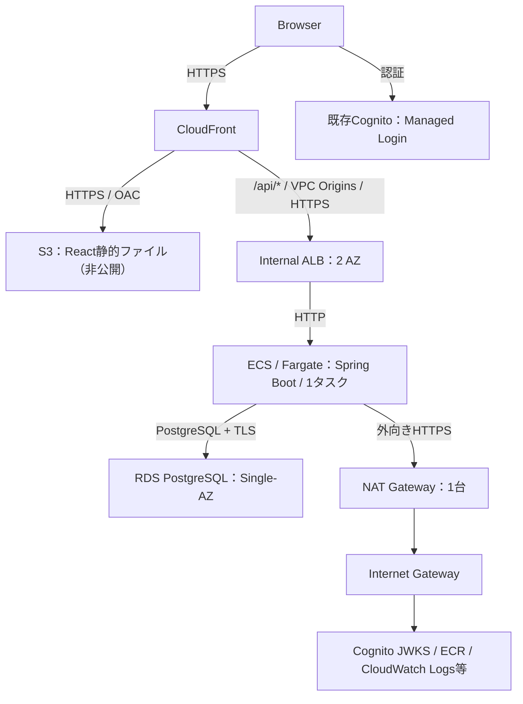

# AWSアーキテクチャ設計

## 1. 目的・対象範囲

座席予約システムをAWSへデプロイし、Terraformによるインフラ構築とGitHub ActionsによるCI/CDを実践するための設計を定義する。

- 冗長性とリソーススペックは最小構成とする。
- 必要時に構築し、検証後に削除するBuild & Scrap運用を採用する。
- 一時リソースはTerraformで管理し、永続リソースから分離する。
- 既存アプリケーションへの変更は最小限にする。
- 可用性より構築の簡素化とコスト抑制を優先する。

関連設計：[CI/CD設計](cicd-design.md)

本書は設計を示し、AWSへの構築完了を意味しない。環境設定は第2章に集約し、構築・デプロイ手順は[Terraform README](../../terraform/README.md)に記載する。

## 2. 環境設定

以下はTerraformの設定方針と環境固有の入力値を示す。「未設定」の項目はapply前に設定する。

### 2.1 AWSリージョン

| 設定項目 | 設定値 |
|---|---|
| メインリージョン | `ap-northeast-1`（現行テンプレートの対象） |

### 2.2 ドメイン・証明書

| 設定項目 | 設定値 |
|---|---|
| アプリケーション公開FQDN | 未設定 |
| ALB Origin用FQDN（HTTPS接続用） | 未設定 |
| CloudFront用ACM証明書ARN | 未設定（手動作成済み証明書） |
| ALB用ACM証明書ARN | 未設定（手動作成済み証明書） |

- ドメイン・DNSレコードはRoute 53、TLS証明書はACMで手動管理する。TerraformにはFQDNと証明書ARNを指定する。
- CloudFront用ACM証明書は`us-east-1`、ALB用はメインリージョンに作成する。
- ACM証明書はDNS検証を利用する。

### 2.3 Terraform State管理

| 設定項目 | 設定値 |
|---|---|
| Backend方式・Lock方式 | S3 Backend / S3ネイティブロック（`use_lockfile = true`） |

Terraform Stateは一時環境と分離して永続管理する。暗号化・アクセス制御・ロックを適用する。

### 2.4 DB認証情報管理

| 設定項目 | 設定値 |
|---|---|
| DB認証情報の保存・配布方式 | RDS管理のSecrets Manager Secret / ECS起動時に注入 |

初期構成ではRDS管理ユーザーでFlywayとアプリを実行する。Secretローテーション後はECSを再デプロイする。DB接続は`sslmode=require`でTLS暗号化し、CA・ホスト名検証は行わない。

### 2.5 実装時の設定・関連設計

- CIDR、AZ、ARN、インスタンススペック等の具体値はTerraformで管理する。VPC Origins非対応の物理AZを除外して2 AZを選択する。
- CI/CDの実行条件や復旧手順は`cicd-design.md`で管理する。

## 3. 全体構成

CloudFrontをアプリケーションの唯一の公開入口とする。FrontendとAPIは同一ドメインで公開する。Cognito Managed Loginは独立した公開認証エンドポイントを使用する。

## 4. リソース・配置設計

| リソース | 構成・配置方針 |
|---|---|
| CloudFront | Distribution 1つ |
| S3 | Reactビルドファイルを保存し、OACで非公開アクセス |
| VPC | 1つ、2 AZを使用 |
| Public Subnet | NAT Gateway用に1つ |
| Private Subnet | 各AZに1つ、計2つ |
| Internet Gateway | 1つ |
| NAT Gateway | メインリージョンに1台 |
| ALB | メインリージョンのPrivate Subnetに配置するInternal ALB、2 AZ |
| ECS Cluster / Service | 各1つ |
| Fargate | 初回構築時は0タスク。イメージPush後はPrivate Subnetで1タスク稼働、Public IPなし |
| ECR | Backendコンテナイメージを保存 |
| RDS PostgreSQL | メインリージョンのPrivate SubnetにSingle-AZで1インスタンス、Publicly Accessible無効 |
| Cognito | 既存User Poolを継続利用、手動管理 |

ALBの要件を満たすために2 AZを使用するが、ECSとRDSの稼働リソースは冗長化しない。ECS Auto Scaling、RDS Multi-AZ、Read Replicaは採用しない。AWSの要件を満たす範囲でSubnetを共有する。

Subnet CIDRはVPC CIDRの範囲内で重複しないように設定する。

動作可能な最小構成を選択する。

初期値はECSが0.25 vCPU / 1 GiB、RDSが`db.t4g.micro` / 20 GiB。ECRリポジトリ名は`seat-reservation-app`とし、イメージタグは変更不可とする。

## 5. ネットワーク・通信設計

| 接続元 | 接続先 | 通信方式・経路 |
|---|---|---|
| Browser | CloudFront | HTTPS |
| CloudFront | S3 | HTTPS / OAC |
| CloudFront | Internal ALB | HTTPS / VPC Origins / ACM |
| Internal ALB | ECS / Fargate | HTTP |
| ECS / Fargate | RDS PostgreSQL | PostgreSQL + TLS |
| ECS / Fargate | AWS公開サービス等 | HTTPS / NAT Gateway / Internet Gateway |

ECSからCognito JWKS、ECR、CloudWatch Logsなどの必要な公開エンドポイントに接続する。

### 5.1 Security Group

| 対象 | 許可する接続元 |
|---|---|
| ALB | CloudFront VPC Originsのみ |
| ECS | ALBのSecurity Groupのみ |
| RDS | ECSのSecurity Groupのみ |

Internal ALB、ECS、RDSへのインターネットからの直接アクセスを許可しない。

## 6. ドメイン・証明書設計

DNSはRoute 53、TLS証明書はACMで管理し、証明書の検証にはDNS検証を使用する。CloudFront用ACM証明書は`us-east-1`で管理する。ALB用ACM証明書はALBと同じメインリージョンで管理し、ALB Origin用FQDNと証明書名を整合させる。

証明書は手動作成・検証を完了してから、ARNをTerraformへ渡す。Terraformは証明書とDNSレコードを作成・削除しない。Hosted Zone IDの入力は不要とし、構築後の`dns_records`出力でCloudFront・ALBのAlias接続先を確認して手動設定する。環境再作成時にはAliasを更新する。

CognitoのCallback URLとLogout URLは、確定したアプリケーション公開FQDNに合わせる。

## 7. CloudFront設計

| Path Pattern | Origin | キャッシュ |
|---|---|---|
| `/api`・`/api/*` | Internal ALB | 無効 |
| Default (`*`) | S3 | 有効 |

API用Behaviorは以下を満たす。

- Authorizationヘッダーを転送する。
- 必要なクエリパラメータを転送する。
- GET / POST / DELETE等の必要なHTTPメソッドを許可する。
- APIレスポンスをキャッシュしない。
- SPA用フォールバックがAPIエラーを上書きしないようにする。

APIは`CachingDisabled`と`AllViewerExceptHostHeader`を使用し、Origin用FQDNをHostとして転送する。SPAのフォールバックはS3用BehaviorのCloudFront Functionで実施する。

## 8. 認証・認可設計

- Reactは既存Cognito User PoolのManaged Loginを使用する。
- APIへのリクエストにはAccess TokenをBearer Tokenとして送信する。
- Spring SecurityでJWTを検証する。
- 管理者権限はCognito Groupsを使用する。
- 予約所有者の認可はService層で実施する。

CognitoのUser Pool、App Client、Groups、Cognito DomainはTerraform管理対象から除外し、手動管理を継続する。既存ユーザーと`sub`を維持し、一時環境の削除による消失を防ぐ。Terraformでは既存Cognitoの識別情報を参照する。

## 9. Terraform管理設計

### 9.1 管理境界

| 区分 | 対象 | 管理・削除方針 |
|---|---|---|
| 一時リソース | VPC / Subnet / Route Table / Internet Gateway / NAT Gateway / Security Group | Terraformで作成・削除 |
| 一時リソース | Internal ALB / Target Group / Listener / ECS / Fargate / ECR / RDS PostgreSQL | Terraformで作成・削除 |
| 一時リソース | S3 / CloudFront / VPC Origins / OAC / 必要なIAM Role・Policy / その他アプリケーション稼働用リソース | Terraformで作成・削除 |
| 手動管理リソース | ACM証明書 / 公開・Origin用DNSレコード / DNS検証レコード | Terraform管理対象外。環境削除・再作成時の公開／Origin用レコードは手動で削除・更新 |
| 永続リソース | 既存Cognito関連リソース | 手動管理。一時環境のdestroy対象外 |
| 永続リソース | Terraform State保存先 | 一時環境のdestroy対象外 |
| 永続リソース | Route 53 Hosted Zone | 一時環境のdestroy対象外 |

### 9.2 State管理

- Terraform StateはGitリポジトリにコミットしない。
- State保存先は一時環境と分離して永続管理し、Build & Scrapの削除対象から除外する。
- Stateには暗号化・アクセス制御・ロックを適用する。
- GitHub Actionsからアクセス可能とし、必要最小限のIAM権限を付与する。
- State保存先の初期構築は、一時環境に依存しない方式とする。

`terraform/bootstrap`でState用S3を独立構築し、バージョニング・暗号化・HTTPS強制・削除防止を設定する。Bootstrap自身のStateはローカルで安全に保管する。

State操作用IAM権限は、対象バケットの`ListBucket`、Stateキーの`GetObject` / `PutObject`、同じキーに`.tflock`を付けたロックオブジェクトの`GetObject` / `PutObject` / `DeleteObject`に限定する。

入力はルートの`terraform.tfvars`に集約し、`dev`・東京リージョン・タスク数0または1という環境方針をルートで検証する。子モジュールはBackendを`application`・`deployment`、Frontendを`routing`に分け、起動前提やFargateのCPU・メモリの組み合わせを検証する。CPU・メモリ・起動猶予は入力から調整できる。

### 9.3 Build & Scrap

1. Terraform applyでECRを含む一時AWS環境を構築する。ECS Serviceのタスク数は0とする。
2. BackendイメージをPushし、digestとCognito設定を指定してタスク数を1にする。Frontend成果物をS3へ配置する。
3. 動作を検証する。
4. Terraform destroyで一時リソースを削除する。
5. 既存Cognitoと永続リソースが維持されていることを確認する。

RDSの予約データが環境削除によって失われることを許容する。構築・デプロイの実行条件や承認方法は[CI/CD設計](cicd-design.md)で管理する。

一時RDSは削除保護・最終スナップショット・自動バックアップ保持を無効にする。S3の成果物とECRイメージも環境とともに削除する。
