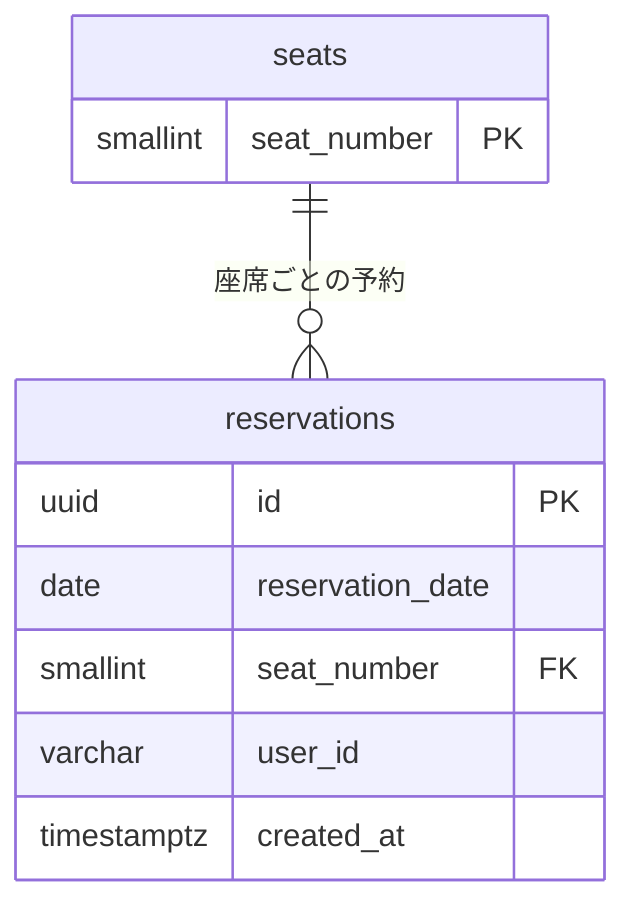

# データモデル定義

## 1. 概要

Phase 1のデータモデルは、`seats`（座席マスタ）と`reservations`（予約）の2テーブルで構成する。データベースはPostgreSQLを使用する。

## 2. テーブル間の関連



1つの座席に対して、日付の異なる複数の予約を登録できる。各予約は必ず1つの座席を参照する。

## 3. seats（座席マスタ）

全日付で共通の座席番号のみを管理する。マスタに存在する座席を予約可能な座席と定義する。

| カラム名    | データ型 | NULL許可 | デフォルト | 制約                                 | 説明     |
| ----------- | -------- | -------- | ---------- | ------------------------------------ | -------- |
| seat_number | SMALLINT | 不可     | なし       | PRIMARY KEY、CHECK (seat_number > 0) | 座席番号 |

### 初期データ

- 初期構築時に、`seat_number`が1〜30の30レコードを登録する。
- 座席数の変更に対応するため、座席番号の上限を30に固定するDB制約は設けない。

## 4. reservations（予約）

予約時にレコードを作成し、キャンセル時に物理削除する。日付別の予約レコードの事前生成は行わない。

| カラム名         | データ型     | NULL許可 | デフォルト        | 制約                                | 説明                               |
| ---------------- | ------------ | -------- | ----------------- | ----------------------------------- | ---------------------------------- |
| id               | UUID         | 不可     | なし              | PRIMARY KEY                         | 予約ID。アプリケーションで生成する |
| reservation_date | DATE         | 不可     | なし              | 複合UNIQUEの構成カラム              | 予約対象日。日単位で管理する       |
| seat_number      | SMALLINT     | 不可     | なし              | FOREIGN KEY、複合UNIQUEの構成カラム | 予約対象の座席番号                 |
| user_id          | VARCHAR(128) | 不可     | なし              | —                                   | 予約したユーザーの識別子           |
| created_at       | TIMESTAMPTZ  | 不可     | CURRENT_TIMESTAMP | —                                   | 予約レコードの作成日時             |

### 制約

| 制約名                    | 対象                          | 内容                                                                     |
| ------------------------- | ----------------------------- | ------------------------------------------------------------------------ |
| pk_reservations           | id                            | 予約を一意に識別する                                                     |
| fk_reservations_seat      | seat_number                   | seats(seat_number)を参照する。参照中の座席の削除・座席番号変更は禁止する |
| uq_reservations_date_seat | reservation_date, seat_number | 同一日付・同一座席の二重予約を禁止する                                   |

### 業務ルール

- 同一ユーザーが同じ日に複数席を予約することは許可する。`reservation_date`と`user_id`の組み合わせにUNIQUE制約は設けない。
- 予約対象日は日本時間（`Asia/Tokyo`）で当日以降とし、アプリケーションで検証する。
- 座席番号の有効性は、マスタに存在することを基準に判定する。
- ユーザーマスタを作成せず、`user_id`に外部キーを設定しない。ローカル用仮ユーザーの識別子を保存する。
- キャンセル時にはアプリケーションで所有者を確認し、対象レコードをDELETEする。予約履歴・キャンセル履歴は保持しない。

## 5. DDL・初期データ定義

以下は初期構築用のSQL定義とする。Flywayの初期マイグレーションで、テーブル作成後に座席マスタを登録する。

```sql
CREATE TABLE seats (
    seat_number SMALLINT NOT NULL,
    CONSTRAINT pk_seats PRIMARY KEY (seat_number),
    CONSTRAINT ck_seats_seat_number_positive CHECK (seat_number > 0)
);

CREATE TABLE reservations (
    id UUID NOT NULL,
    reservation_date DATE NOT NULL,
    seat_number SMALLINT NOT NULL,
    user_id VARCHAR(128) NOT NULL,
    created_at TIMESTAMPTZ NOT NULL DEFAULT CURRENT_TIMESTAMP,
    CONSTRAINT pk_reservations PRIMARY KEY (id),
    CONSTRAINT fk_reservations_seat
        FOREIGN KEY (seat_number) REFERENCES seats (seat_number)
        ON UPDATE RESTRICT ON DELETE RESTRICT,
    CONSTRAINT uq_reservations_date_seat
        UNIQUE (reservation_date, seat_number)
);

INSERT INTO seats (seat_number)
SELECT generate_series(1, 30);
```

主キーとUNIQUE制約により作成されるインデックスを使用する。予約日を先頭にした複合UNIQUEのインデックスは、日付別の予約照会にも利用できる。追加インデックスは実際の検索条件・性能に応じて検討する。
