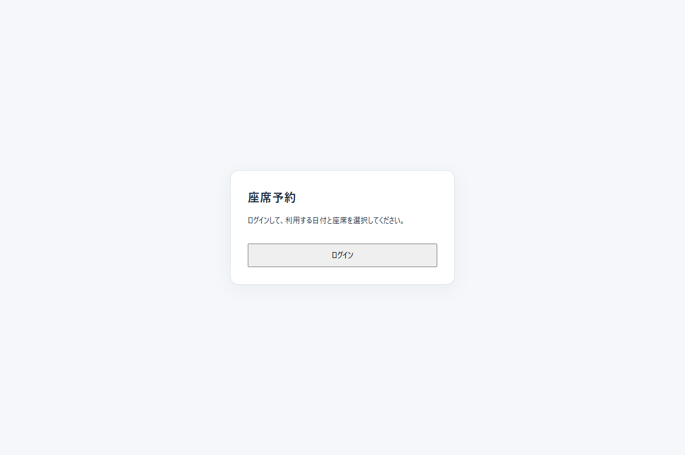
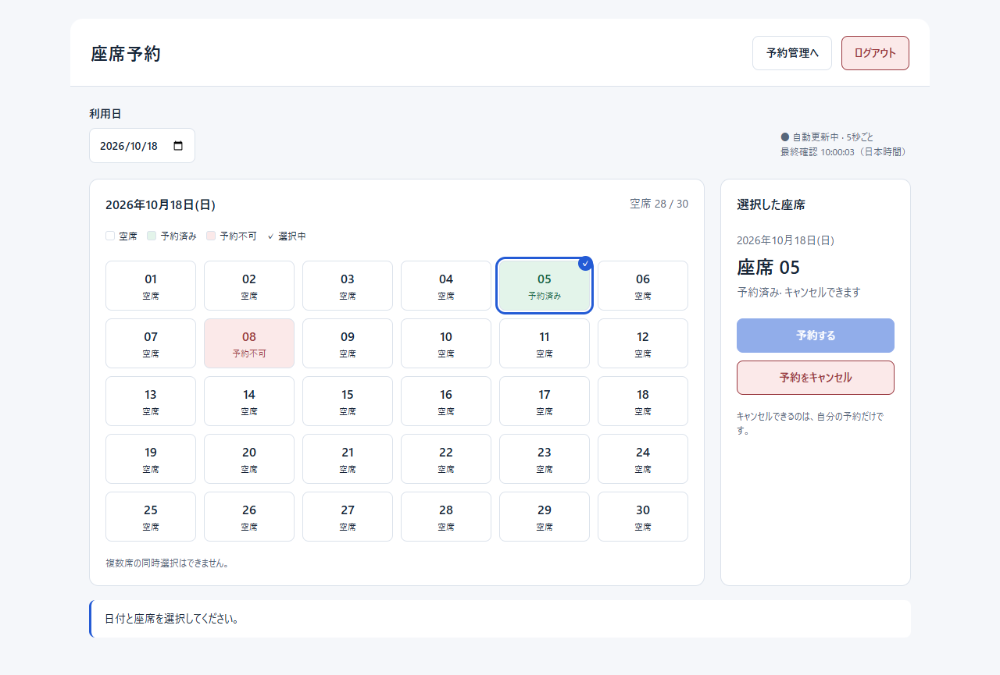
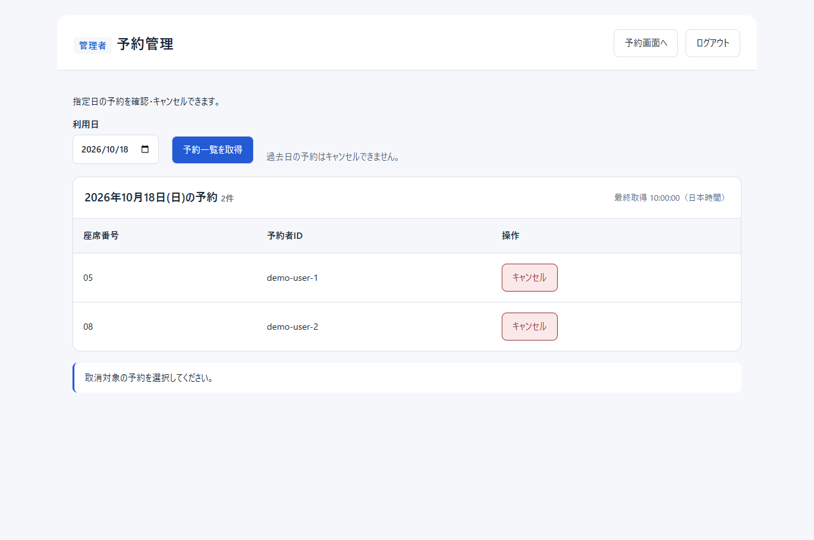
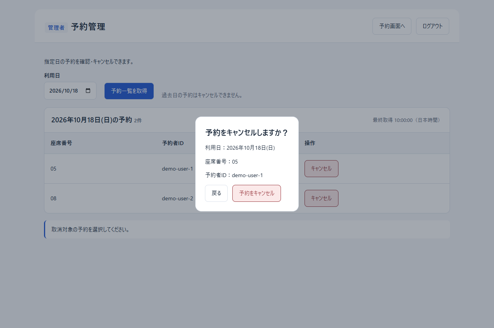

# フロントエンド仕様

## 画面構成

React + TypeScriptで実装したログイン画面・座席予約画面・管理者予約一覧画面。Cognitoで認証後、権限による分岐なしで予約画面へ進む。利用日を指定し、認証ユーザーに対する座席の状態を表示する。空席の予約と、自分の予約のキャンセルを1席ずつ実行する。

### 画面イメージ

ログイン画面：

一般予約画面（Phase 1時点の参考画像。現在は仮ユーザー入力を削除し、ログアウトと管理者向けを追加）：

管理者予約一覧：

キャンセル確認：

ログイン・管理者画面は実装から取得した画像。予約者はテスト用データであり、Cognitoのログイン画面は含めない。

### URLと表示条件

| URL | 表示・役割 |
| --- | --- |
| `/login` | 未認証時のログイン画面。認証済みなら予約画面へ移る |
| `/auth/callback` | OIDCライブラリが認証応答を処理。成功後は権限を問わず`/reservations`へ移る |
| `/reservations` | 認証済みユーザーの一般予約画面 |
| `/admin/reservations` | 認証済みかつ`ADMINS`の管理者画面。一般ユーザーなら`/reservations`、未認証なら`/login`へ移る |

ログイン前の管理URLへは自動復帰しない。Tokenはメモリ保持のため、管理画面を含むページ再読み込みでは再ログインが必要。

### 一般予約画面の表示領域

| 領域 | 内容 |
| --- | --- |
| タイトル | 「座席予約」、ログアウトボタン。管理者には「予約管理へ」も表示 |
| 条件入力 | 利用日 |
| 更新情報 | 取得中・処理中・更新失敗などの状態、最後に取得成功した時刻（日本時間） |
| 座席一覧 | 日付、空席数／総席数、状態の凡例、座席番号と状態文字、選択の説明 |
| 操作パネル | 選択した日付・座席・状態、「予約する」「予約をキャンセル」、処理中表示 |
| 通知 | 操作結果・取得失敗時は別の通知と「再取得」ボタン |

初期値は日本時間の当日、座席未選択。ユーザーは認証済みJWTのsubで識別する。座席数はAPI応答に従い、全席表示する。

### 座席の表示と操作

座席の状態と実行可能アクションは下記の通りとする。

| API状態 | 表示 | 選択 | 予約 | 予約キャンセル |
| --- | --- | --- | --- | --- |
| `AVAILABLE` | 空席・通常背景 | 可 | 可 | 不可 |
| `MINE` | 予約済み・緑系背景 | 可 | 不可 | 可 |
| `OCCUPIED` | 予約不可・赤系背景 | 不可 | 不可 | 不可 |

- 単一選択とし、選択枠とチェックを表示する。同じ席の再クリックで解除し、別席のクリックで選択を切り替える。選択だけではAPIへの書き込みは行わない。
- 過去日も取得・表示できるが、全席の選択と予約・キャンセルは不可とし、閲覧のみの説明を表示する。
- 日付未入力・無効な日付ではGETを行わず、利用日を指定する案内を表示する。予約・キャンセルも不可。
- 初回取得中、取得失敗、座席未登録（取得成功かつ空配列）は別の表示とする。未取得の状態を空席として扱わない。
- 書き込み中は日付・座席・両操作ボタンを無効化する。

### レイアウトと操作性

- 通常は座席6列で、操作パネルを右側に配置する。幅760px以下では操作パネルを下に配置し、幅420px以下では座席を3列にする。
- OS・ブラウザの設定に応じたライト／ダークテーマに対応する。
- 状態は色と文字で表現し、座席のアクセシブルな名前には番号と所有状態を含める。選択は`aria-pressed`で表現する。
- キーボードのフォーカス枠を表示する。選択情報・操作結果・取得失敗に通知領域を設け、最終確認時刻は通知領域に含めない。

## コンポーネント構成

画面の組み立てと状態管理を分離する。Propsや個別関数の仕様はコードを参照する。

| コンポーネント・モジュール | 主要な責務 |
| --- | --- |
| [App](../../frontend/src/App.tsx) | 認証状態・管理者グループによる画面切替、ログイン・ログアウト・失効処理 |
| [LoginPage](../../frontend/src/pages/LoginPage.tsx) | ログイン開始、処理中表示、設定・認証エラーと再試行 |
| [authConfig](../../frontend/src/auth/authConfig.ts) | OIDC設定・戻り先検証、メモリ保存、ログアウトURL生成 |
| [main](../../frontend/src/main.tsx) | 認証設定とAuthProviderの初期化。設定不正時のエラー画面 |
| [SeatReservationPage](../../frontend/src/pages/SeatReservationPage.tsx) | 画面全体の組み立て、各領域への状態と操作の接続、更新情報の表示 |
| [ReservationFilters](../../frontend/src/components/ReservationFilters.tsx) | 利用日の入力 |
| [SeatMap](../../frontend/src/components/SeatMap.tsx) | 座席一覧、凡例、空席数、取得状況・過去日の案内 |
| [SeatButton](../../frontend/src/components/SeatButton.tsx) | 1席の状態・選択表示と選択操作 |
| [ReservationActionPanel](../../frontend/src/components/ReservationActionPanel.tsx) | 選択内容と予約・キャンセル操作、処理中表示 |
| [ResultMessage](../../frontend/src/components/ResultMessage.tsx) | 操作結果、取得失敗、手動再取得の導線 |
| [useSeatReservation](../../frontend/src/hooks/useSeatReservation.ts) | 日付・座席・選択・通知の状態管理、取得と書き込み、ポーリング、応答の競合制御 |
| [API Client（reservations.ts）](../../frontend/src/api/reservations.ts) | 一般向けAPIのURL・メソッド・本文の定義。共通通信処理はapi/client.tsへ委譲 |
| [jaDate](../../frontend/src/utils/jaDate.ts) | 日本時間の当日判定、日付の妥当性、日付・時刻の表示 |

## 一般予約画面のデータ更新・状態管理

### Backendとの整合性

座席状態はGET応答を正とする。予約・キャンセル時に座席状態を先行して書き換える楽観的更新は行わず、書き込み後のGETで表示を確定する。ユーザー切替時もフロントエンドで所有状態を反転せず、新しいユーザーのGET応答を使用する。

| 操作 | HTTP | 扱い |
| --- | --- | --- |
| 座席取得 | `GET /api/seats?date=YYYY-MM-DD` | 指定日の全席を取得。応答の日付が要求日付と異なる場合は適用せず、取得失敗として扱う |
| 予約 | `POST /api/reservations` | 本文は`date`と`seatNumber`。通常の成功応答は201 |
| キャンセル | `DELETE /api/reservations/{id}` | 選択した`MINE`の予約IDを使用。本文なし。204ではJSON解析しない |

全リクエストに`Authorization: Bearer <Access Token>`を送り、キャッシュを使用しない。ID TokenはAPIに送らない。APIの詳細は[API定義](api-definition.md)を参照。

### 再取得の契機

| 契機 | 選択・表示の扱い |
| --- | --- |
| 初期表示 | ログイン完了後に当日・認証ユーザーで取得。完了まで座席選択と書き込みは不可 |
| 日付変更・別ユーザーでの再ログイン | 選択、旧座席、最終確認時刻、通知、取得エラーをクリアし、新しい条件で取得。同じ条件への変更は何もしない |
| 定期更新 | 前回GETが成功または失敗で完了してから5秒後に再取得 |
| タブの再表示 | 即時取得を試みる。進行中GETがある場合は重複開始しない |
| 予約・キャンセル完了 | 401を除き成功・エラーのいずれでも結果通知、選択解除、GET再取得。再取得完了までは座席操作を停止 |
| 手動再取得 | 取得失敗表示の「再取得」から実行。取得中は同ボタンを無効化 |

画面上の「自動更新中·5秒ごと」は、リクエスト開始からの固定周期ではなく、前回GET完了後の待ち時間を表す。タブ非表示中は新規取得を開始せず、既に進行中のGETは完了し得る。書き込み中もポーリングを停止する。

### 定期更新時の選択と表示

- 通常の定期GET待機中は、直前の取得に成功していれば座席操作を継続できる。初回取得・条件変更・手動再取得・書き込み直後の取得待ちとは区別する。
- 座席番号・状態・予約IDと配列順を比較し、同一なら座席配列を置き換えない。取得成功時は変更の有無にかかわらず最終確認時刻を更新する。
- 非選択席のみの変化では選択を維持する。
- 選択席が消えた場合、状態が変わった場合、または自席の予約IDが変わった場合は選択を解除し、「選択中の座席情報が更新されました。」と通知する。
- 操作結果の通知は通常のポーリング成功では消さない。条件変更や次の操作などで更新する。

### 古い応答と二重送信の防止

日付変更・別ユーザーでの再ログイン、書き込み開始、取得処理の切替時に旧GETを中断する。中断だけに頼らず取得世代と終了状態も確認し、遅れて届いた旧応答を適用しない。書き込み前のGETが後から返っても、書き込み後の再取得結果を上書きさせない。

同じ取得世代でGETを重複実行しない。書き込みには即時の実行中ガードを設け、画面の無効化が反映される前の連続操作も抑止する。画面破棄時は定期タイマーとイベントを解除し、GETを中断する。書き込み自体の取り消しは行わず、破棄後の結果による画面状態の更新を抑止する。

### エラーと回復

| 状況 | 通知・回復 |
| --- | --- |
| 401・トークン期限切れ | ポーリング停止、予約画面と認証状態を破棄しログイン画面で再認証を案内。書き込みの自動再送なし |
| 409 Conflict | 「この座席は先に予約されました。別の空席を選択してください。」を通知し、選択解除・再取得 |
| 404 | 対象予約が見つからない旨を通知し、選択解除・再取得 |
| その他の500未満のHTTPエラー | ProblemDetailの`detail`を表示。解析できなければ代替文言。選択解除・再取得 |
| 書き込みの通信切断・10秒タイムアウト・HTTP 500以上 | 「操作の結果を確認できません。最新の座席情報を確認してから操作してください。」と通知。選択解除・再取得し、書き込みを自動再送しない |
| GET失敗（401を除く）・10秒タイムアウト | 選択を解除し、座席操作を停止。最後の座席情報と最終確認時刻を保持し、取得失敗と再取得ボタンを表示。5秒後の自動再取得も継続 |
| 書き込み成功後のGET失敗 | 書き込みの成功通知を保持し、取得失敗を別表示。最新情報を確認できるまで座席操作を停止 |

通信タイムアウトはGET・POST・DELETE共通で10秒。HTTP通信の中断はBackend処理の取り消しを保証しないため、結果不明時にはGETで現在の座席を確認する。GET成功は、結果不明だった書き込みの成否を個別に確定するものではなく、結果不明通知も自動で成功通知には変えない。

### 日本時間の日付境界

当日・過去日の判定は`Asia/Tokyo`を使用し、Backendも同じタイムゾーンで検証する。画面表示中は1秒ごと、およびタブの表示状態変更時に当日を再判定する。選択中の日付が過去日になった場合は選択解除・操作不可とするが、利用日を翌日に自動変更しない。選択・書き込みの実行時にも当日を確認する。端末とサーバーの時計差による最終的な受付可否はBackendの応答に従う。

## ログインと認証状態

`App`が認証状態と管理者権限に応じて`LoginPage`・`SeatReservationPage`・`AdminReservationPage`を表示する。`authConfig`がCognitoの接続先と戻り先を検証する。設定不足時はログインを無効にし設定エラーを案内する。

`/login`からCognito Managed Loginへ移動し、Authorization Code + PKCEで認証する。`react-oidc-context`が`/auth/callback`でstate検証とトークン交換を行い、URLの認証パラメータを除去して`/reservations`へ遷移する。失敗時はログイン画面で再試行できる。一般ユーザー・管理者とも同じ予約画面を使用する。

トークンはメモリのみ、認証途中のstate/PKCEはsessionStorageに保持する。自動トークン更新は行わない。再読み込み・期限切れ・APIの401ではログインが必要となる。ログアウトはメモリ上の認証状態を削除後にCognitoのlogoutへ遷移する。403は再認証へ転送せずエラー表示する。

認証処理中はログインボタンを無効化する。ログイン・ログアウトに失敗した場合は詳細な内部情報を表示せず、再試行を案内する。管理者の表示制御には`cognito:groups`を使い、APIの最終的な認可はBackendが行う。グループ変更後は再ログインする。

設定値・Cognitoの許可URL・本番配信の前提は[Frontend README](../../frontend/README.md#認証設定)を参照。

## 管理者画面

`App`が認証済みユーザーの`cognito:groups`に`ADMINS`が含まれる場合だけ管理者画面への導線を表示する。ログイン後は一般予約画面を表示し、管理者は「予約管理へ」で`/admin/reservations`へ切り替える。一般ユーザーが管理URLへ移動しても管理者画面・管理APIを利用しない。Backendによる認可を併用する。

| ファイル | 責務 |
| --- | --- |
| [AdminReservationPage](../../frontend/src/pages/AdminReservationPage.tsx) | 管理者画面の組み立てと一般予約画面への戻り・ログアウト |
| [AdminReservationFilters](../../frontend/src/components/AdminReservationFilters.tsx) | 日付と手動取得。初期値は日本時間の当日 |
| [AdminReservationTable](../../frontend/src/components/AdminReservationTable.tsx) | 対象日・件数・最終取得時刻、座席番号・予約者ID・キャンセルボタン、未取得・0件・取得中 |
| [CancelReservationDialog](../../frontend/src/components/CancelReservationDialog.tsx) | 日付・座席・予約者を確認するモーダル。戻る／確定。処理中は閉じる操作も抑止 |
| [useAdminReservations](../../frontend/src/hooks/useAdminReservations.ts) | 一覧と確認対象の状態管理、GET／DELETE、古いGETの中断・応答破棄 |
| [api/adminReservations.ts](../../frontend/src/api/adminReservations.ts) | 管理者用GET／DELETE |
| [api/client.ts](../../frontend/src/api/client.ts) | 一般向け・管理者向けのBearer送信、タイムアウト、ProblemDetail処理 |
| [types/adminReservation.ts](../../frontend/src/types/adminReservation.ts) | date、reservations（id・seatNumber・userId）の型 |

### 一覧取得・キャンセル

| 操作 | HTTP | 扱い |
| --- | --- | --- |
| 一覧取得 | `GET /api/admin/reservations?date=YYYY-MM-DD` | 指定日の全予約を座席番号順に表示。予約者IDは全文表示し、氏名・メールアドレスは取得しない |
| キャンセル | `DELETE /api/admin/reservations/{id}` | 日付・座席・予約者を確認して確定。管理者は他人の予約も取消可能。成功応答は204 |

- 初期日は日本時間の当日。初期表示・日付変更では取得せず、明示操作を待つ。日付変更時に旧一覧・取得時刻・通知・確認対象を破棄する。
- 一覧は手動取得とし、定期更新しない。未取得・0件・取得中・取得失敗を区別する。
- 過去日は閲覧のみ。確認中の日付越えと確定時にも過去日を判定し、キャンセルを抑止する。
- 取消中は日付変更と追加操作を無効化し、二重送信を防ぐ。401以外の結果では一覧を再取得する。
- 画面破棄時はGETとタイマーを終了し、遅い応答を反映しない。送信済みDELETEのサーバー処理は取り消さない。

### エラーと回復

| 状況 | 通知・回復 |
| --- | --- |
| 401・期限切れ | 表示中の画面を破棄して再認証を案内。取消後の再取得は行わない |
| GET 403 | 一覧をクリアし、管理者権限がない旨を通知 |
| その他の取得失敗・応答日付不一致 | 直前の一覧・時刻を保持し、取消を停止。手動再取得を案内 |
| DELETE 400・403・404 | APIのエラー文言を通知し、一覧を再取得 |
| DELETEの通信障害・タイムアウト・500以上 | 結果不明を通知し再取得。DELETEの自動再送なし |
| 取消成功後の取得失敗 | 成功通知を保持し、取得失敗を別表示 |

### レイアウトと操作性

確認ダイアログは日付・座席番号・予約者IDと「戻る」「予約をキャンセル」を表示する。キーボード操作に対応し、閉じた後は呼出元へフォーカスを戻す。取消中は戻る・確定・Escapeによる終了を抑止する。長い予約者IDは折り返し、小さい画面でも全文と操作ボタンを確認できるようにする。

検証項目は[フロントエンドテストマトリクス](../testing/frontend-test-matrix.md)を参照。
