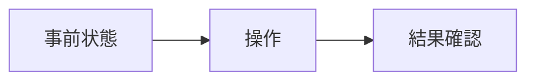
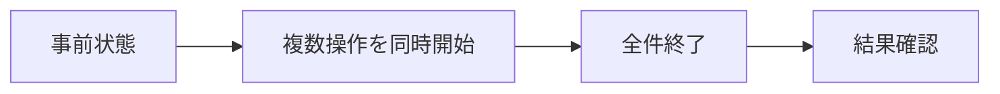
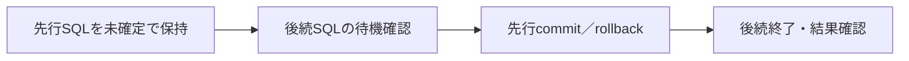

# Transaction / Concurrency テスト定義

## 目的・対象範囲

同時予約・キャンセル時のAPI応答と、Transactionのcommit / rollback後のDB整合性を検証する。既存のUNIQUE制約とServiceの`@Transactional`で要件を満たすかを確認し、追加のロックや例外処理が必要かを判断する。

- 一意性：任意の日付・座席について、確定予約は最大1件。
- 原子性：rollbackされたINSERT / DELETEの変更が残らない。
- 所有者制約：一般向けAPIでは非所有者が予約を削除できない。
- 独立性：別日付・別座席の操作が成功し、無関係な予約を変更しない。
- 応答と終了：競合を適切なHTTP応答に変換し、Transaction終了後に待機が解消される。

性能測定、接続プールの最適化、分散ロック、リトライ、Idempotency-Key、スケールアウトは対象外。並列テストの成功だけで全スケジューリングの正しさや直列化の不存在を証明したとは扱わない。

## 現行実装と検証上の注意

| 項目 | 現行実装・確認点 |
| --- | --- |
| 予約登録 | `ReservationService.reserve()`が`@Transactional`。過去日判定・座席存在確認後に`save()`。空席の事前確認は行っていない |
| キャンセル | `cancelOwnReservation()`が`@Transactional`で明示DELETEの`deleteReservationById()`を実行。削除件数0は`ReservationNotFoundException`。予約取得・所有者確認・過去日確認もServiceの同一Transaction内にある。管理者用はcancelReservationAsAdminで所有者確認だけを省略する |
| 一意性 | Flywayで`uq_reservations_date_seat`：`UNIQUE (reservation_date, seat_number)`を定義 |
| 例外変換 | `GlobalExceptionHandler`は`ReservationNotFoundException`を404、対象UNIQUE制約の`DataIntegrityViolationException`を409へ変換。それ以外のDB整合性エラー・想定外例外は500 |
| 分離レベル | Serviceに明示指定なし。実接続で`SHOW transaction_isolation`を実行し、検証前提の`read committed`であることを確認する |
| SQL発行時点 | `save()`の呼び出しだけでINSERT発行を断定しない。flush / commit時のSQL・例外を観測する |
| ユーザー | localを含めJWTのsubで識別する。A/Bは既存ケースを維持するテスト用subであり、許可ユーザー数の上限ではない。管理者も一般APIでは所有者判定を受ける |

## テスト構成

実装先は以下の2クラスに分ける。

| 実装先 | 担当する実装用ID | 方式 |
| --- | --- | --- |
| `ReservationConcurrencyIntegrationTest` | `*-API`、`*-API-CHECKED`、`*-API-HELD` | A：実HTTP → Controller → Service → JPA → PostgreSQL。順次・並列・順序制御を含む |
| `ReservationTransactionIntegrationTest` | `*-DB`、`*-SVC*`、`*-HYBRID` | B：独立DB接続、S：Serviceプロキシと実JPA、H：先行DBと後続HTTPの組合せ |

業務層・DBをモックしない。DB方式では各接続のauto-commitを無効化し、SQL発行とcommit / rollbackを制御する。S方式では外側Transactionへの参加とService自身のTransactionを区別する。直接SQLにはHTTPステータスを割り当てず、所有者チェックの検証にも代用しない。

### ケースIDとテストメソッドの関連付け

- **定義表の1行＝1実装用ID＝1テストメソッド**とする。簡易フロー表の同じIDはその行の説明であり、別テストではない。
- 元のID（例：R-03）は要件のまとまりとして保持し、方式ごとに`R-03-API`、`R-03-DB`へ分割する。元IDだけのテストメソッドは作らない。
- 同じ方式でも独立した検証は接尾辞で区別する。例：`C-01-API-CHECKED`、`T-06-SVC-FLUSH`、`T-06-SVC-COMMIT`。
- `@DisplayName`の先頭に完全な実装用IDを必須で記載する。Javaメソッド名は動作を表す名前とし、MDにメソッド名を転記した対応表は作らない。
- パラメータ化・反復テストは1メソッドの複数実行として扱い、引数・反復番号を実行結果に残す。全実行の成功で、そのIDをOKとする。複数の実装用IDを1メソッドに割り当てない。
- 実装単位の結果を個別に管理する。元の要件を完了と判断するには、その元IDに属する必須実装用IDがすべてOKであることを確認する。

```java
@Test
@DisplayName("R-03-API: 異なるユーザーの同時予約は一方だけ成功する")
void concurrentReservationsByDifferentUsers() {
    // R-03-APIの実施方法・期待動作を検証する
}
```

### 共通環境・データ

- Java 25、Maven Wrapper、Dockerが利用可能な環境。既存の`ReservationApiIntegrationTest`に合わせ、Testcontainersの`postgres:17-alpine`、`local` / `test`プロファイル、Flywayを使用する。
- テスト用`Clock.fixed(...)`を設定し、アプリケーションの日本時間の当日をDとする。DとD+1、座席1・2（マスタは1〜30）を使用する。
- A＝テストJWTの`sub=demo-user-1`、B＝`sub=demo-user-2`。POSTは`/api/reservations`、本文は`{"date":"実日付","seatNumber":1}`、`Content-Type: application/json`、`Authorization: Bearer <操作ユーザーのテスト用Access Token>`を指定する。DELETEは`/api/reservations/{id}`。
- 各ケースの事前データは明示的にcommitする。テストメソッド全体に`@Transactional`を付けず、各操作のTransactionと検証用接続を分離する。
- 同じDBを使うテストケースは直列実行し、ケース内部の操作だけを並列化する。各反復で初期化し、前の反復の成功データを再利用しない。
- 対象予約とは別にD+1・座席30の予約を1件用意し、全項目が維持されることを確認する。表の「予約件数」は対象キーまたは対象ID群の件数であり、この監視用予約を含めない。
- 全Worker終了・全Transaction終了後、別接続でDBを検証する。JPAの管理済みEntityや未クリアのキャッシュだけで判定しない。

## 実施方法

### 共通フロー

各パターンの「簡易フロー」は、以下の3種類を基に操作順序だけを示す。期待結果の詳細・許容される分岐・後処理は既存の定義を参照する。矢印は手順の順序を表し、「同時」は開始を同期することを表す。

**順次実行**



**並列実行**



**Transaction制御**



Transaction制御の図はSQLが競合する場合に適用する。C-04-HYBRIDの権限拒否では後続SQLの待機を要求せず、個別の簡易フローに従う。APIと直接SQLの結果は区別し、各実装用IDの「構成・実施方法」に従って実施する。

### A：API並列実行

キャンセルの同期はService入口ではなく、所有者・過去日確認を通過した後の`ReservationRepository.deleteReservationById()`実行前に置く。C-01-API-CHECKEDは両方のDELETE到達を待つ。C-03-APIのBEFORE_COMMITはBの`findById()`が存在する予約を取得したことを確認してからAの削除を進める。JWT移行後のユーザー判定に`X-Demo-User`を使わず、検証済み認証の`sub`を参照する。

1. DBの事前状態を作成・commitし、件数と内容を保存する。
2. リクエスト数以上のWorkerを持つ`ExecutorService`を用意する。全Workerの準備完了を待ってから`CountDownLatch`または`CyclicBarrier`で送信を開始する。
3. 全レスポンスを回収し、ステータス、本文、成功ユーザー、予約IDを記録する。勝者や完了順序は固定しない。
4. DB最終状態と共通検証条件を照合する。自由な並列ケースとC-01-API-CHECKEDは各10回反復し、1回でも不一致ならNGとする。C-03-APIはFREEのみ10回、BEFORE_COMMIT／AFTER_COMMITは各1回。A-HELDは各1回とする。
5. `finally`でWorker・HTTPクライアント・接続を終了し、その後に専用DBの予約データをクリーンアップする。

開始時刻の同期だけではDB上の競合を保証しない。R-01-DB / R-03-DB / C-01-DBで未コミットSQLへの競合を別途確認する。C-01-API-CHECKEDではテスト専用の同期処理で両方のService内の検証後・RepositoryのDELETE実行前を保留し、C-01-APIの自由な同時実行と分ける。

### A-HELD：先行Transaction保留中に後続HTTPが完了することを確認

1. 実ServiceプロキシのTransactionInterceptorより内側にテスト専用Adviceを追加する。Repository側の取消同期処理と区別する。
2. AのHTTPを開始し、Serviceの実処理後にflushする。同じTransactionのJDBCでINSERT／DELETEが反映されたこと、有効なTransaction・read committed・DB PIDを確認してからAを保留する。Bの同じService操作は保留しない。
3. AのSQL発行・保留通知を待ってから、別リソースへのBのHTTPを開始する。Aを解放せず、Bの成功応答を期限内に回収する。A/BのDB PIDが異なることを確認する。
4. B完了時もAのFutureは未完了、解放ラッチは未解除、Transaction完了通知は未発生であり、`pg_stat_activity`上でAが`idle in transaction`かつTransaction IDを保持することを確認する。
5. 観測用の別接続でBのcommit結果を確認する。AのINSERTはまだ見えず、AのDELETE対象は元の全項目が見えることを検証する。監視用予約も維持する。
6. Aを解放し、COMMITTED通知・成功応答と最終DB状態を確認する。finallyでも必ず解放し、Workerを終了してAdviceを除去する。

SQL発行通知・Bの完了期限は各10秒、Aの保留期限・解放後の応答回収期限は各30秒、Worker終了期限は35秒。Bの回収失敗時は`pg_stat_activity`のSQL・待機種別・阻止PIDを記録する。タイムアウトはNGだが、原因はDB待機・接続不足・その他エラーを切り分ける。

各ケースを1回実行する。検証範囲は「AのSQL実行後からcommitまでの区間で、BがAのTransaction終了を待たずに完了できること」。短時間の内部ロック、Aの保留区間より前の直列処理、すべての実行順序における直列化の不存在は証明しない。INSERTのSQL発行時点をflushで制御するため、通常スケジュールの既存I-01〜03-APIも残す。

### B / H：SQLの順序とTransaction終了を制御

1. T1/T2は必ず別接続とし、それぞれのバックエンドPIDを取得する。制御・観測用に別接続を確保する。
2. T1でINSERTまたはDELETEを実行して未コミットで保持する。JPAを使う場合は明示flushしてSQL発行を確認する。
3. T2の競合SQLを開始する。観測接続から`pg_stat_activity`と`pg_blocking_pids(pid)`を確認し、T2がT1を待機していることを期限付きで検出する。単なる一定時間のsleepやFuture未完了だけでロック待機と判定しない。
4. 表で指定したT1のcommit / rollbackを実行する。T2の結果を回収し、成功ならcommit、SQLエラーならrollbackする。
5. 新しい接続で最終状態を検証する。H方式で非所有者が403を返すケースはSQL待機を要求せず、T1が未終了の間に権限拒否されることを確認する。

準備・待機検出の期限は各10秒、HTTP / Futureの完了期限は各30秒を初期値とする。制御付き接続には例として`lock_timeout=15s`、`statement_timeout=20s`を設定し、設定値を結果に記録する。タイムアウトを期待する試験ではないため、期限超過はNGとする。失敗時は必ずT1を解放してT2を終了させ、必要なら専用接続のSQLをキャンセルしてrollbackする。後処理も期限を設け、終了できなければコンテナを破棄する。

## APIテスト：ReservationConcurrencyIntegrationTest

実HTTPで応答とDB最終状態を検証する。通常操作・順次実行・同期による順序制御もこのクラスに含める。

### Transaction境界・正常終了・例外

| 実装用ID | パターン | 目的 | 構成・実施方法 | 期待動作 | 結果 |
| --- | --- | --- | --- | --- | --- |
| T-02-API | 予約成功のcommit | 201と永続化が一致すること | A：空席へPOST完了後、別接続で検索 | 201。応答ID・日付・座席とDBが一致し、所有者Aの予約1件 | OK |
| T-03-API | キャンセル成功のcommit | 204と削除確定が一致すること | A：Aの予約をDELETE後、別接続で検索 | 204、本文なし。対象0件、他の予約は保持 | OK |
| T-06-API | 通常POSTのUNIQUE違反 | Service終了時の例外が409へ変換されること | A：予約済みキーへ通常POSTし、SQL発行・例外発生箇所・原因を観測する | 409のProblemDetail。既存予約を全項目維持し追加0件。例外の型・発生箇所を記録 | OK |
| T-07-API | UNIQUE以外のDBエラー | DBエラーを一律409にしないこと | A：専用DBにテスト用INSERTトリガーを一時作成し、指定キーだけSQLSTATE `23514`の制約エラーを発生させPOST。終了後にトリガー・関数を除去 | 500のProblemDetail、対象0件。409にならず、解除後のPOSTは201。注入した500のみ期待値 | OK |

| 実装用ID | 簡易フロー |
| --- | --- |
| T-02-API | 空席 → POST → 201 → 別接続で予約1件を確認 |
| T-03-API | 予約あり → DELETE → 204 → 別接続で対象0件を確認 |
| T-06-API | 予約あり → 重複POST → 409 → 元予約維持 |
| T-07-API | DBエラーを注入 → POSTは500 → 対象0件を確認 → 注入解除後のPOST成功 |

### 予約登録

初期状態はD・座席1が空席。T1は先行、T2は後続のTransaction。APIの自由な並列実行では勝者を固定しない。

| 実装用ID | パターン | 目的 | 構成・実施方法 | 期待動作 | 結果 |
| --- | --- | --- | --- | --- | --- |
| R-01-API | 同一ユーザー・同一座席への同時POST | 自分自身との重複防止 | A：Aから同じキーへ2件同時POST | 201×1、409×1。成功応答のID・所有者で予約1件。勝者を固定しない | OK |
| R-03-API | 異なるユーザー・同一座席への同時POST | ユーザー間の二重予約防止 | A：A/Bから同じキーへ同時POST | 201×1、409×1。成功応答のID・所有者で予約1件。勝者を固定しない | OK |
| R-05-API | 同一座席へ10件の同時POST | 多数の競合でも一意性・応答数が維持されること | A：A/Bを5件ずつ、計10Workerから同じキーへPOST | 201×1、409×9。成功応答のID・所有者で予約1件。400・500・タイムアウトなし | OK |

| 実装用ID | 簡易フロー |
| --- | --- |
| R-01-API | 空席 → 2件同時POST → 201×1／409×1 → 勝者の予約1件 |
| R-03-API | 空席 → 2件同時POST → 201×1／409×1 → 勝者の予約1件 |
| R-05-API | 空席 → 10件同時POST → 201×1／409×9 → 勝者の予約1件 |

### キャンセル

初期状態はD・座席1にAの予約が1件存在し、commit済み。

| 実装用ID | パターン | 目的 | 構成・実施方法 | 期待動作 | 結果 |
| --- | --- | --- | --- | --- | --- |
| C-01-API | 同一予約への自由な同時DELETE | 二重キャンセルの整合性とAPI応答 | A：Aから同じ予約IDへ2件同時DELETE。開始だけを同期し、取得・削除順序は固定しない | 目標：204×1、404×1、対象0件。二重204・500は目標未達 | OK |
| C-01-API-CHECKED | 両方の存在確認後にDELETEが競合 | 存在確認通過後の競合でも目標のAPI応答になること | A：テスト専用同期処理で両リクエストをServiceの存在・所有者・過去日確認後、RepositoryのDELETE実行前まで進める。その後削除を解放し、SQL・例外を記録する | 目標：204×1、404×1、対象0件。二重204・500は目標未達 | OK |
| C-03-API | 異なるユーザー・所有者がcommit | 非所有者の操作を拒否すること | A：パラメータ化テストで①自由な同時DELETE（FREE：10回）、②Bの行取得をAの削除確定前に制御（BEFORE_COMMIT：1回）、③Aの204後にBが取得（AFTER_COMMIT：1回）、の3条件を独立実行する | Aは204。Bは①403または404、②403、③404。対象0件、不正削除なし。3条件すべての成功でOK | OK |
| C-05-API | 異なるユーザー・非所有者が先行 | 不正操作が正当な操作を妨げないこと | A：BのDELETEが403になった後に元予約維持を確認し、AがDELETE。自由な並列順序はC-03-APIで確認 | Bは403、その時点で元予約維持。Aは204、最終0件 | OK |

| 実装用ID | 簡易フロー |
| --- | --- |
| C-01-API | Aの予約あり → 同時DELETE → 目標204×1／404×1 → 対象0件 |
| C-01-API-CHECKED | Aの予約あり → 両DELETEの存在確認通過 → 削除を解放 → 応答・対象0件を確認 |
| C-03-API | Aの予約あり → 条件別にA・BのDELETE順序を設定 → 応答・対象0件を確認 |
| C-05-API | Aの予約あり → BのDELETEは403・元予約維持 → AのDELETEは204 → 対象0件 |

### 異なるリソース

| 実装用ID | パターン | 目的 | 構成・実施方法 | 期待動作 | 結果 |
| --- | --- | --- | --- | --- | --- |
| I-01-API | 同一日付・異なる座席 | 座席単位で独立して予約できること | A：D・座席1とD・座席2が空席。A/Bが同時POST | 両方201、各キー1件、計2件。ID・所有者が各応答と一致 | OK |
| I-02-API | 同一座席・異なる日付 | 一意性が日付と座席の組であること | A：DとD+1の座席1が空席。A/Bが同時POST | 両方201、各日1件、計2件。IDは異なる | OK |
| I-03-API | 異なる予約の同時キャンセル | 無関係な削除が互いを壊さないこと | A：AのD・座席1、BのD・座席2を登録し各所有者が同時DELETE | 両方204、対象2予約は0件、監視用予約は保持 | OK |
| I-01-API-HELD | 同日・別座席、先行INSERTを保留 | 別座席の予約が先行commitを待たず完了すること | A-HELD：AのD・座席1へのHTTP POSTをSQL発行後に保留し、BがD・座席2へPOST | A保留中にBが201、別接続でBの予約1件・Aの予約0件。A解放後は201、各キー1件、監視用予約を保持 | OK |
| I-02-API-HELD | 別日・同一座席、先行INSERTを保留 | 同じ座席でも別日なら先行commitを待たず完了すること | A-HELD：AのD・座席1へのHTTP POSTをSQL発行後に保留し、BがD+1・座席1へPOST | A保留中にBが201、別接続でBの予約1件・Aの予約0件。A解放後は201、各日1件、監視用予約を保持 | OK|
| I-03-API-HELD | 別予約、先行DELETEを保留 | 別予約の取消が先行commitを待たず完了すること | A-HELD：AのD・座席1、BのD・座席2を登録。AのHTTP DELETEをSQL発行後に保留しBが自分の予約をDELETE | A保留中にBが204・本文なし、Bの予約0件、Aの元予約は全項目参照可能。A解放後も204・本文なし、対象2予約0件、監視用予約を保持 | OK |

| 実装用ID | 簡易フロー |
| --- | --- |
| I-01-API | 同日・別座席が空席 → 同時POST → 両方201 → 各座席に予約1件 |
| I-02-API | 別日・同一座席が空席 → 同時POST → 両方201 → 各日付に予約1件 |
| I-03-API | 異なる予約が2件 → 各所有者が同時DELETE → 両方204 → 対象0件 |
| I-01-API-HELD | AのINSERTを保留 → 別座席のBが201・DB反映 → Aを解放 → Aも201 |
| I-02-API-HELD | AのINSERTを保留 → 別日付のBが201・DB反映 → Aを解放 → Aも201 |
| I-03-API-HELD | AのDELETEを保留 → 別予約のBが204・DB反映 → Aを解放 → Aも204 |

### キャンセルと再予約

初期状態はD・座席1にAの予約が1件存在し、commit済み。

| 実装用ID | パターン | 目的 | 構成・実施方法 | 期待動作 | 結果 |
| --- | --- | --- | --- | --- | --- |
| M-03-API | キャンセル完了後の再予約 | APIでの一連の再予約成功 | A：AのDELETE 204を受信後、BがPOST | 204→201。Bの新IDの予約1件、Aの旧IDなし | OK |
| M-04-API | DELETEとPOSTの自由な同時実行 | 実APIで順序依存の結果が整合すること | A：AのDELETEとBのPOSTの送信開始を同期。自動再送しない | Aは204。Bが201なら最終はBの予約1件、Bが409なら最終0件。旧予約を見て先に競合判定される409を許容し、500は不許容 | OK |

| 実装用ID | 簡易フロー |
| --- | --- |
| M-03-API | Aの予約あり → AのDELETEは204 → BのPOSTは201 → Bの新予約1件 |
| M-04-API | Aの予約あり → AのDELETE・BのPOSTを同時開始 → 応答別に最終状態を確認 |

## Transactionテスト：ReservationTransactionIntegrationTest

直接DB操作（DB）、Service検証（SVC）、先行DB Transactionと後続HTTPの組合せ（HYBRID）をこのクラスに配置する。HYBRIDはHTTPを含むが、保留Transactionの解放を管理するためこちらに置く。

### Transaction境界・正常終了・例外

| 実装用ID | パターン | 目的 | 構成・実施方法 | 期待動作 | 結果 |
| --- | --- | --- | --- | --- | --- |
| T-01-SVC | 境界・分離レベルの確認 | 想定した処理単位で検証できること | S：reserve / cancelOwnReservationを引数とするパラメータ化テスト。外側TransactionなしでServiceプロキシを呼び、内部のTransaction有効性・分離レベル・終了をテスト専用観測処理で確認。Controller側の境界はコードも照合する | reserve / cancelOwnReservation内でTransactionが有効、`read committed`。予約取得・所有者確認・過去日確認・削除が同じTransaction内であり、ControllerにはTransaction属性がないことを記録 | OK |
| T-04-SVC | INSERT後のrollback | SQL発行済みの登録が取り消されること | S：TransactionTemplate内でService.reserveを呼びflush後、テスト用RuntimeExceptionを送出。例外はTransactionの外で捕捉 | 外側Transactionがrollbackし対象0件。次の独立したPOSTは201。HTTP 500の検証とは扱わない | OK |
| T-05-SVC | DELETE後のrollback | 削除失敗で既存予約が失われないこと | S：外側Transaction内でService.cancelOwnReservationを呼びflush後、RuntimeExceptionを送出 | 同一ID・所有者・全項目の予約が残る。次の独立したDELETEは204 | OK |
| T-06-SVC-COMMIT | Transaction終了時のUNIQUE違反 | 明示flushなしでも制約違反が成功扱いにならないこと | S：外側Transaction内でServiceから重複登録し、明示flushせずTransactionを終了。例外の発生箇所・型・原因を観測する | 対象UNIQUE制約違反でrollback。既存予約は全項目維持、追加0件。早期SQL発行ならその事実を記録し、commit時の例外を再現したとは扱わない | OK |
| T-06-SVC-FLUSH | 明示flushでのUNIQUE違反 | SQL発行時の制約違反でTransactionがrollbackすること | S：外側Transaction内でServiceから重複登録し、明示flushする。例外はTransaction外で捕捉し発生箇所を記録 | 対象UNIQUE制約違反でrollback。既存予約は全項目維持、追加0件。HTTP応答は検証しない | OK |

| 実装用ID | 簡易フロー |
| --- | --- |
| T-01-SVC | Service呼出し → 境界・分離レベルを観測 → Transaction終了を確認 |
| T-04-SVC | ServiceでINSERT・flush → 例外でrollback → 対象0件を確認 → 再POST成功 |
| T-05-SVC | ServiceでDELETE・flush → 例外でrollback → 元予約を確認 → 再DELETE成功 |
| T-06-SVC-COMMIT | 予約あり → 重複登録 → 明示flushせずTransaction終了 → 違反箇所・rollbackを確認 |
| T-06-SVC-FLUSH | 予約あり → 重複登録・明示flush → 一意違反・rollback → 元予約維持 |

### 予約登録

初期状態はD・座席1が空席。T1は先行、T2は後続のTransaction。APIの自由な並列実行では成功トランザクションを固定しない。

| 実装用ID | パターン | 目的 | 構成・実施方法 | 期待動作 | 結果 |
| --- | --- | --- | --- | --- | --- |
| R-01-DB | 同一ユーザー・同一座席、T1 commit | 自分自身との重複防止 | B：AのT1 INSERTを保持し、AのT2 INSERTの待機を確認してT1 commit | T2は対象制約のSQLSTATE `23505`でrollback。T1のIDでAの予約1件 | OK |
| R-02-DB | 同一ユーザー・同一座席、T1 rollback | 失敗した登録で占有されないこと | B：AのT1 INSERTを保持、AのT2 INSERTの待機確認後にT1 rollback | T2のINSERT・commit成功。T1のIDは残らず、T2のIDでAの予約1件 | OK |
| R-03-DB | 異なるユーザー・同一座席、T1 commit | ユーザー間の二重予約防止 | B：AのT1 INSERTを保持し、BのT2 INSERTの待機を確認してT1 commit | T2は対象制約のSQLSTATE `23505`でrollback。T1のIDでAの予約1件 | OK |
| R-04-DB | 異なるユーザー・同一座席、T1 rollback | 後続ユーザーが予約できること | B：AのT1 INSERTを保持しBのT2を待機させrollback | T2がINSERT・commit成功。Bの予約1件、T1のIDは残らない | OK |
| R-06-DB | 同一座席へ異なる10ユーザーのINSERT | 元案の10ユーザー条件でDB一意性を確認 | B：異なるuser_idとIDの10接続で同時INSERTし、各接続で成功直後にcommit、失敗時rollback | commit成功1件、対象制約の`23505`が9件。勝者の予約1件。HTTPや認証の検証には数えない | OK |

| 実装用ID | 簡易フロー |
| --- | --- |
| R-01-DB | 同一ユーザーのT1 INSERT → T2が待機 → T1 commit → T2は一意違反 |
| R-02-DB | 同一ユーザーのT1 INSERT → T2が待機 → T1 rollback → T2が登録・commit |
| R-03-DB | AのT1 INSERT → BのT2が待機 → T1 commit → T2は一意違反 |
| R-04-DB | AのT1 INSERT → BのT2が待機 → T1 rollback → T2が登録・commit |
| R-06-DB | 空席 → 10ユーザーで同時INSERT・各Transaction終了 → 成功1件／一意違反9件を確認 |

### キャンセル

初期状態はD・座席1にAの予約が1件存在し、commit済み。

| 実装用ID | パターン | 目的 | 構成・実施方法 | 期待動作 | 結果 |
| --- | --- | --- | --- | --- | --- |
| C-01-DB | 同一予約のDELETE競合、T1 commit | 先行削除確定後の後続DELETE更新件数を確認 | B：T1 DELETEを保持し、T2 DELETEの待機を確認してT1 commit | T1の削除件数1、T2の削除件数0。T2をcommitし対象0件。HTTP応答は検証しない | OK |
| C-02-DB | 同一ユーザー・同一予約、T1 rollback | 削除失敗後に後続が削除できること | B：T1 DELETEを保持し、T2 DELETEの待機を確認してT1 rollback | T2の削除件数1、commit成功。対象0件 | OK |
| C-02-HYBRID | 同一ユーザー・同一予約、T1 rollback | 先行削除のrollback後に実APIでキャンセルできること | H：T1で未コミットDELETEを保持。AのHTTP DELETEがSQL待機に到達したことを確認してT1 rollback | 後続HTTPは204、本文なし。対象0件。直接SQLのT1にはHTTP応答なし | OK |
| C-04-HYBRID | 異なるユーザー・所有者側がrollback | rollback後も所有権が維持されること | H：Aの予約をT1でDELETEし未コミット保持、BのHTTP DELETEが終了してからT1 rollback | Bは403。Aの元予約1件が全項目維持。T1は直接SQLなのでHTTP応答なし | OK |

| 実装用ID | 簡易フロー |
| --- | --- |
| C-01-DB | T1 DELETE → T2が待機 → T1 commit → T2の削除件数0 |
| C-02-DB | T1 DELETE → 後続DELETEが待機 → T1 rollback → 後続が削除成功・対象0件 |
| C-02-HYBRID | 未確定DELETE → AのHTTP DELETEが待機 → T1 rollback → 204・対象0件 |
| C-04-HYBRID | Aの予約を未確定DELETE → BのHTTP DELETEは403 → 先行rollback → Aの元予約を確認 |

### キャンセルと再予約

初期状態はD・座席1にAの予約が1件存在し、commit済み。

| 実装用ID | パターン | 目的 | 構成・実施方法 | 期待動作 | 結果 |
| --- | --- | --- | --- | --- | --- |
| M-01-DB | 未コミットDELETEとINSERT、DELETE commit | 解放された一意キーを後続が取得できること | B：T1 DELETEを保持、BのT2 INSERTの待機を確認してT1 commit | T2のINSERT・commit成功。新IDでBの予約1件、Aの旧IDなし | OK |
| M-02-DB | 未コミットDELETEとINSERT、DELETE rollback | キャンセル失敗時に元予約を保護すること | B：T1 DELETEを保持、BのT2 INSERTを待機させT1 rollback | T2は対象制約の`23505`でrollback。Aの元予約1件が全項目維持 | OK |

| 実装用ID | 簡易フロー |
| --- | --- |
| M-01-DB | T1 DELETE → T2 INSERTが待機 → T1 commit → T2が登録・commit |
| M-02-DB | T1 DELETE → T2 INSERTが待機 → T1 rollback → T2は一意違反・元予約維持 |

## 共通の確認

- 201：レスポンスのID・日付・座席、`Location`、成功ユーザーとDBが一致する。
- 204：本文なし。400/401/403/404/409/500：API仕様のProblemDetailの`Content-Type`、`status`、`title`、`detail`、`instance`を照合する。通常の競合ケースの500はNG。
- DB：対象件数・ID・所有者・日付・座席・作成日時を確認。rollback・権限拒否では既存行の全項目が維持される。無関係な監視用予約も維持される。
- 一意性：以下の検証SQLが0行であることを確認する。ただしUNIQUE制約そのものの存在確認、成功件数、所有者照合の代用にはしない。

```sql
SELECT reservation_date, seat_number, COUNT(*)
FROM reservations
GROUP BY reservation_date, seat_number
HAVING COUNT(*) > 1;
```

- 完了性：全Futureを回収し、未終了Transaction・ロック待機・後処理エラーがない。失敗した反復を再実行で上書きしてOKにしない。
- DB方式のrollback成功だけで、APIやServiceの例外変換を検証済みにしない。結果は実装用IDごとに記録し、別IDの成功で代用しない。
